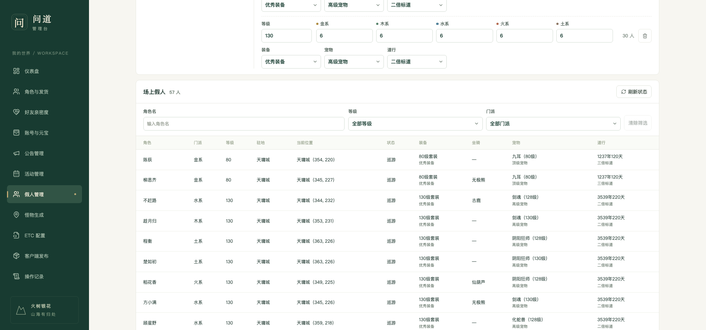
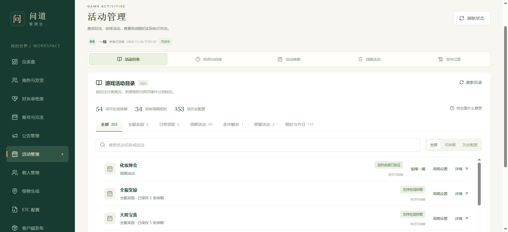
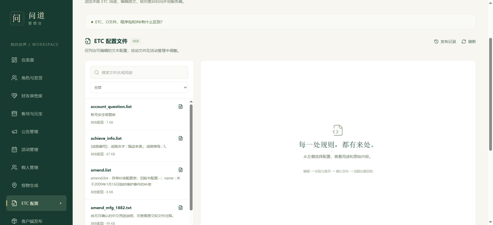
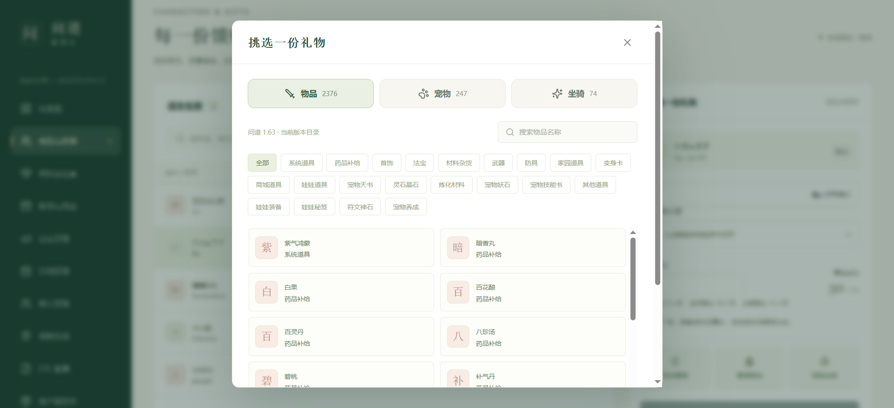
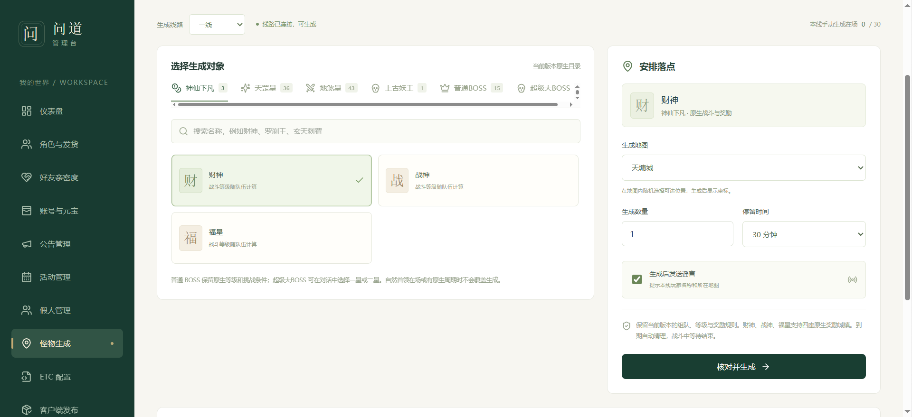

# 问道 1.63 服务端与管理台

一个 Docker Compose 项目启动 1.63 一线游戏服、MySQL 和 Web 管理台。首次启动导入空服种子，并为当前安装生成独立的后台管理员和数据库凭据。

## 下载与启动

在 [Release 下载完整的 `wendao163-compose.zip`](https://github.com/fuyuanshun/wendao163-compose/releases/latest)，解压后进入 `wendao163-compose` 目录。使用 Docker Engine 或 Docker Desktop 的 Linux 容器模式。

```sh
docker compose up -d --build
docker compose ps
docker compose run --rm --no-deps setup admin
```

游戏一线显示 `healthy` 后，打开本机后台 `http://127.0.0.1:18888`，使用最后一条命令给出的管理员信息登录。在「账号与元宝」注册游戏账号，然后用现有的 1.63 客户端登录。默认登录端口为 `18101`，一线端口为 `18160`。局域网连接方式见压缩包内的 README。

已有安装可在原目录更新包内文件并重新执行 `docker compose up -d --build`。已有账号、角色和配置存放在原 Compose 项目的命名卷里。

## 后台管理功能

### 假人管理

按地图、等级配置五系人数，每个等级组可独立选择经典或新版角色形象、装备、宠物和标道。假人由服务端生成，可在游戏里邀请组队、快速组队和切磋，组队后可带着宠物参与战斗。天墉城的空闲假人在擂台下方站街。后台按角色名、等级或门派查找在场假人，并分页查看位置、培养情况和掠阵宠物。

战斗中假人会参考队长的攻击目标。体木会用群毒和群疗，敏水优先补防，假人和出战宠物可用高级血玲珑救人。BOSS 结算后，假人留在原队。



### 活动管理

按玩法分类查询活动目录，查看支持的排期方式、时间规则和线路状态。对可发布的活动安排单场或周期排期，并从发布记录核对实际执行结果。



### ETC 配置

按文件名或用途浏览可编辑的文本配置，查看原文、保存草稿和核对差异。确认发布后，在后台查看线路加载回执和历史发布记录。



### 角色与发货

查询角色，通过同版目录分类筛选并搜索物品、宠物和坐骑，选择后按对应规则发放。后台也提供账号与元宝、好友亲密度、公告及操作记录等常用管理入口。



### 怪物生成

从本版原生目录选择神仙、天罡星、地煞星、上古妖王和 BOSS 等对象。指定线路、地图、数量及停留时间，可选发送谣言，确认后查看在场对象和位置。挑战及奖励走游戏原生规则。


